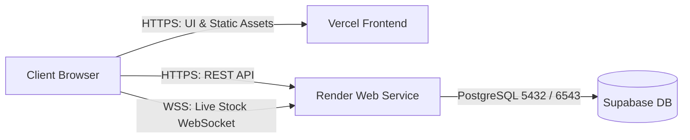

# 🚀 Deployment Guide: Vercel (Frontend) & Render (Backend)

This project is configured for cloud deployment using:
- **Render**: Hosts the Spring Boot backend (`/api` REST endpoints & `/ws/stock` WebSocket real-time synchronization).
- **Vercel**: Hosts the React + Vite frontend single-page application (SPA).
- **Supabase**: PostgreSQL cloud database (Session Pooler).

---

## 📋 Architecture Overview



---

## Step 1: Push Code to GitHub

Make sure your latest code and configurations are pushed to GitHub:

```bash
git add .
git commit -m "Configure app for Vercel and Render deployment"
git push origin main
```

---

## Step 2: Deploy Backend to Render

### Option A: 1-Click Blueprint (Recommended)
1. Go to [Render Dashboard](https://dashboard.render.com).
2. Click **New +** > **Blueprint**.
3. Select your GitHub repository (`cpmonline`).
4. Render will read [`render.yaml`](file:///d:/_____________Python%20Programming/__IVAN%20PB%20MARKET/cpmonline/render.yaml) automatically.
5. In the environment setup prompt:
   - Provide your `SPRING_DATASOURCE_PASSWORD` (Supabase DB password).
   - Click **Apply**.
6. Render will build the Docker container and start your Spring Boot backend.

### Option B: Manual Web Service Setup
1. In Render, click **New +** > **Web Service**.
2. Connect your GitHub repository.
3. Choose **Docker**:
   - **Name**: `cpmonline-backend`
   - **Region**: `Singapore` (or region closest to your Supabase instance)
   - **Branch**: `main`
   - **Root Directory**: Leave blank (or `.`)
   - **Dockerfile Path**: `Dockerfile` (or `backend/Dockerfile`)
   - **Plan**: `Free`
4. Expand **Advanced** > **Environment Variables** and add:
   | Key | Value | Notes |
   |---|---|---|
   | `PORT` | `10000` | Port Render routes to |
   | `SPRING_DATASOURCE_URL` | `jdbc:postgresql://aws-0-ap-northeast-1.pooler.supabase.com:5432/postgres?sslmode=require` | Supabase JDBC URL |
   | `SPRING_DATASOURCE_USERNAME` | `postgres.nphhtnndxkkjodzyoacw` | Supabase DB username |
   | `SPRING_DATASOURCE_PASSWORD` | `qrEEOtsgqwRLr7qx` | Your Supabase password |
   | `JWT_SECRET` | *32+ character random string* | Secret for signing auth tokens |
   | `SHOW_SQL` | `false` | Keeps logs clean in production |
5. Set **Health Check Path**: `/api/health`.
6. Click **Create Web Service**.

### Verify Backend Deployment
Once deployed, copy your Render URL (e.g. `https://cpmonline-backend.onrender.com`).
Visit in your browser:
```
https://<YOUR-RENDER-APP>.onrender.com/api/health
```
You should see:
```json
{
  "status": "UP",
  "service": "cpmonline-backend",
  "timestamp": 1729000000000
}
```

---

## Step 3: Deploy Frontend to Vercel

1. Go to [Vercel Dashboard](https://vercel.com/dashboard) and click **Add New...** > **Project**.
2. Import your GitHub repository (`cpmonline`).
3. In the project configuration:
   - **Framework Preset**: `Vite` (automatically detected).
   - **Root Directory**: Click *Edit* and select `frontend` (or leave as root; both have `vercel.json` configured).
4. Expand **Environment Variables** and add:
   | Key | Value | Notes |
   |---|---|---|
   | `VITE_API_URL` | `https://<YOUR-RENDER-APP>.onrender.com` | No trailing slash |
5. Click **Deploy**.

> **Note on WebSockets:** You do *not* need to set a separate WebSocket URL. The frontend automatically translates `https://your-app.onrender.com` into `wss://your-app.onrender.com` for real-time inventory updates!

---

## Step 4: Verification Checklist

- [ ] **Login:** Navigate to your Vercel URL (`https://your-app.vercel.app/login`) and log in with your credentials.
- [ ] **SPA Direct Navigation:** Refresh the page or visit `/orders`, `/inventory`, or `/tablet` directly. The rewrite rules in `vercel.json` ensure no 404 errors.
- [ ] **Live Sync:** Open the application in two browser tabs or on a phone and tablet. Modify an inventory quantity or make a sale. The real-time green badge should remain connected and synchronize changes immediately via WebSocket.

---

## 💡 Troubleshooting & Key Notes

1. **Render Free Tier Cold Starts:**
   Render's free tier spins down after 15 minutes of inactivity. When you open the app after it sleeps, the first request may take 30–50 seconds while the container boots. Subsequent requests are instant.
   - *Tip:* You can use a free uptime monitor (e.g., UptimeRobot, Cron-Job.org) to ping `https://<YOUR-RENDER-APP>.onrender.com/api/health` every 10 minutes to prevent sleeping.

2. **Supabase Pooler Connection Limit:**
   The connection pool in `application.properties` is configured for Supabase Transaction Pooler (`Hikari maximum-pool-size=10`). Avoid setting this higher than 15 on free Supabase tiers.

3. **Monolithic Local Mode Still Works:**
   You can still build and run locally with `deploy.bat` or `mvnw spring-boot:run` on port 8080 whenever you want offline multi-device LAN usage.
